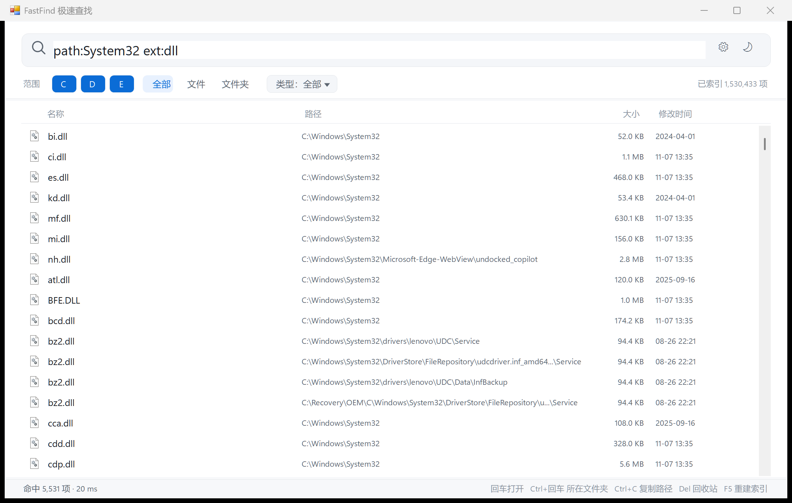
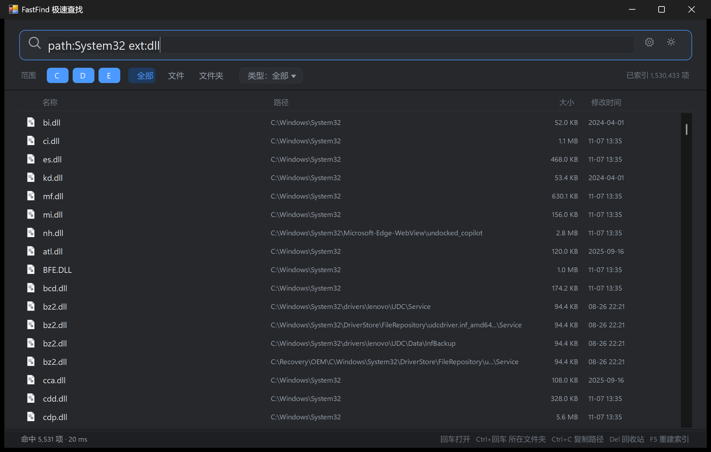

# FastFind · Windows 极速文件查找器

**152 万文件、毫秒级出结果。单文件 110 KB、免安装、零运行时依赖、普通用户权限即可运行。**

Windows 上成熟的搜索工具有 Everything，但它依赖 NTFS USN/MFT，通常需要管理员权限。FastFind 的目标不同：**没有管理员权限也要快**——用普通用户可用的目录枚举建立自有索引，落盘为紧凑二进制缓存，再配合多线程查询，做到"打开即用、输入即搜"。

- 平台：Windows 10 / 11（x64），.NET Framework 4.8（系统自带）
- 体积：单个 `FastFind.exe` 约 110 KB，数据全部放在程序旁的 `data\`
- 权限：`asInvoker`，普通用户即可；不需要管理员、不写注册表、不装服务





---

## 功能

- **索引**：自动识别本机 NTFS 固定盘，多线程并行枚举；索引缓存落盘，二次启动 20–40 ms 载入
- **搜索**：空格分词（AND）、`-排除`、`"短语"`、`*` `?` 通配、`/正则/`、`ext:` `size:` `dm:` `dc:` `path:` `type:` 过滤
- **文件类型多选**：文档 / 图片 / 视频 / 音频 / 压缩包 / 程序 / 代码 / 其他，多选为 OR
- **范围切换**：C: / D: / E: 芯片随时开关，只影响搜索范围，不丢索引；选择随配置保存
- **结果表**：虚拟列表 + 自绘，列头排序（名称 / 路径 / 大小 / 修改时间），命中词高亮
- **操作**：双击 / 回车打开，`Ctrl+回车` 定位到资源管理器，`Ctrl+C` 复制路径，`Del` 删除到回收站（可撤销），右键菜单含打开方式、属性
- **界面**：浅色 / 深色主题实时切换（含标题栏），PerMonitorV2 高 DPI，自绘空状态 / 状态栏
- **便携**：不写注册表、不写系统目录，整个文件夹可拷走

查询语法与快捷键：

| 示例 | 含义 |
| --- | --- |
| `report 2024` | 同时包含 report 和 2024 |
| `report -draft` | 包含 report、不包含 draft |
| `"Q3 report"` | 短语匹配 |
| `*.log` / `IMG_?.png` | 通配符 |
| `/^setup.*\.exe$/i` | 正则 |
| `ext:pdf,docx` | 扩展名（逗号分隔多选） |
| `size:>10mb` / `size:1kb..1mb` | 大小范围 |
| `dm:today` / `dm:2026-01..2026-03` | 修改日期 |
| `path:项目` | 路径包含 |
| `type:dir` / `type:file` | 只看文件夹 / 只看文件 |

| 快捷键 | 功能 |
| --- | --- |
| `Ctrl+F` | 聚焦搜索框 |
| `Enter` | 打开选中项 |
| `Ctrl+Enter` | 打开所在文件夹 |
| `Ctrl+C` | 复制完整路径 |
| `Del` | 删除到回收站 |
| `F5` | 重建索引 |
| `Ctrl+T` | 切换主题 |
| `Ctrl+Alt+Space` | 全局唤出 / 隐藏 |


---

## 设计思路

### 1. 目标与约束决定技术选型

| 约束 | 选择 | 原因 |
| --- | --- | --- |
| 机器上没有 .NET SDK | 用系统自带 `csc.exe`（C# 5）编译 | 零安装、可复现，产物小 |
| 无管理员权限 | 普通用户态 `FindFirstFileExW` 枚举 + 自有缓存 | USN/MFT 需要提权，排除 |
| 便携单文件 | WinForms + .NET Framework 4.8 | 系统自带运行时，exe 仅 110 KB |
| 152 万级条目要"输入即出" | 结构数组（SoA）+ 名称池 + 并行扫描 | 避免 152 万个 `string` 的 GC 与指针开销 |

更完整的取舍与数据布局见 [docs/DESIGN.md](docs/DESIGN.md)。

### 2. 索引：把内存布局当成核心数据结构

每个卷一个 `VolumeIndex`，**不是对象树**，而是并列数组：

```
char[]  Pool       名称字符池（所有名字首尾相接）
int[]   Off        每个节点的名称起点
ushort[] Len       名称长度
int[]   Parent     父节点下标（根为 0）
byte[]  Flags      目录 / 重解析点
byte[]  Category   文件类型分类（文档/图片/…）
long[]  Size       文件大小
int[]   MTime      修改时间（2000-01-01 起的秒）
```

- 一个节点的路径按需由 `Parent` 链拼出，不存重复前缀；152 万条目的常驻内存约 170–215 MB
- 扫描用 8 线程工作队列，`FindExInfoBasic + FIND_FIRST_EX_LARGE_FETCH + ON_DISK_ENTRIES_ONLY` 降低系统调用与属性查询开销
- 目录立即入索引，文件每 4096 条批量合并，减少锁竞争
- 缓存格式 v4：头（魔数/版本/卷序列号/统计）+ 根路径 + 名称池 + 6 个数组，先写 `.tmp` 再原子替换；卷序列号变化自动失效
- 运行期用 `FileSystemWatcher` 防抖后按卷重建，索引器忽略自己的 `data\` 目录，避免"写缓存触发重扫"的自激循环

### 3. 搜索：先过滤，再匹配，最后只排 Top-K

- 查询按空格拆成 AND 词；`-` 开头为排除；引号短语、通配符、正则分别走不同匹配器
- **廉价过滤前置**：类型、扩展名、大小、时间、路径条件在名称匹配前判断，减少无效正则
- 8 线程按节点区间分块并行，每线程维护 5 个 rank 桶（精确 / 前缀 / 词边界 / 子串），最后合并取前 N
- 只对选中集合排序（不是对全部命中排序），152 万条目下查询稳定在 10–50 ms
- 取消用 generation 计数器：新查询自增，旧任务在每个 chunk 边界看到变化即退出，无需锁

### 4. 界面：虚拟化 + 自绘，把 152 万行"画"出来

- `ListView` 开启 `VirtualMode + OwnerDraw + FullRowSelect`，只向系统提供可见行的文本与图标，绝不为全部结果建 `ListViewItem`
- 原生表头被隐藏，换成自绘 `ColumnHeaderRow`，保证与行内容对齐、支持排序箭头、颜色随主题
- 高 DPI 用 `PerMonitorV2` manifest + 手写 `Theme.S()` 缩放（不用 `AutoScaleMode`），避免 200% 下字体/控件错位
- 主题是调色板对象，切换时遍历重绘并调用 DWM 改标题栏颜色，无需重启
- 状态空页分四种：Idle / NoMatch / Indexing / NoScope，把"为什么没结果"讲清楚

### 5. 可靠性：失败必须让用户看见

这是实际使用中踩坑最多的部分，也是 1.2.x 的重点：

- **打开失败不再静默**：`ShellExecute` 失败时弹出自定义提示框（系统 MessageBox 在 200% DPI 会裁字），写明文件名、原因、兜底动作，并复制完整路径
- **限制权限可识别**：检测 Low Integrity / AppContainer，启动即在状态栏提示，失败弹窗给出"请从资源管理器或开始菜单启动"的明确指引
- **定位不启动 explorer.exe**：改用 `SHOpenFolderAndSelectItems`（进程内 shell API），避免受限环境下 explorer.exe 崩溃弹窗；失败则诚实降级为"复制路径"
- **删除进回收站**：`SHFileOperation + FOF_ALLOWUNDO`，误删可撤销
- **单实例**：全局互斥体，再次启动时唤起已有窗口而不是开第二个

### 6. 性能实测（本机：Win11 / 16 线程 / NVMe / 3 块盘）

| 项目 | 结果 |
| --- | --- |
| 单盘 C: 81 万节点首次扫描 | 约 1.7–4.1 s |
| 三盘合计 153 万节点 | 约 4–8 s，缓存 117 MB |
| 缓存保存 / 加载 | 27–38 ms / 21–31 ms |
| 查询 `setup` / `*.log` / `ext:png` | 31–43 ms / 33 ms / 11 ms |
| 常驻内存（153 万节点） | 约 170–215 MB 私有字节 |

---

## 快速开始

1. 从 [Releases](../../releases) 下载 `FastFind-x.y.z-win64.zip`，解压到任意目录（**不要**放在需要管理员权限的目录）
2. 双击 `FastFind.exe`。首次启动会在 `data\index\` 建索引（三块盘约 5–10 秒），之后启动直接读缓存
3. 输入关键词即可搜索

> 便携版不会写注册表。删除整个文件夹即可卸载。

## 构建

不需要 .NET SDK，使用 Windows 自带的 .NET Framework 4 编译器：

```powershell
powershell -NoProfile -File .\build.ps1
```

产物：`dist\FastFind.exe`（内嵌 PerMonitorV2 DPI manifest、图标、版本信息）。

打包：

```powershell
powershell -NoProfile -File .\package.ps1
```

## 测试

```powershell
.\build\EngineTests.exe                          # 70 项引擎断言
.\build\IndexBench.exe C:\ 8                     # 扫描 / 缓存 / 查询基准
powershell -NoProfile -File .\acceptance.ps1     # 端到端验收（20 项检查）
powershell -NoProfile -File .\tests\functional-test.ps1   # GUI 功能回归（14 项）
```

最近一次结果：引擎 70/70、验收 20/20、功能回归 14/14。

## 已知限制

- 无管理员权限时不使用 USN/MFT 快速路径，首次索引是完整目录枚举（之后走缓存）
- 跳过符号链接 / junction，避免目录环
- 默认只索引本机 NTFS 固定盘；网络盘/移动盘可在设置中手动添加
- 运行期刷新是"防抖 + 按卷重建"，文件剧变时会有一次数秒重建
- 若以 Low Integrity（受限令牌）运行（例如从智能体面板、浏览器沙箱启动），Windows 会禁止它启动其他程序。FastFind 会检测并提示；请从资源管理器或开始菜单启动
- 系统默认程序损坏/未关联时无法直接打开，可用右键「选择打开方式…」修复

## 许可证：源码开放，禁止商用

本项目采用 **PolyForm Noncommercial License 1.0.0**：

- ✅ 允许个人学习、研究、自用、修改、分发（需保留许可证与版权声明）
- ❌ **禁止任何商业用途**：不得用于商业产品、收费服务、内部商业流程，或以盈利为目的分发
- 商业授权请先联系作者（见 [COMMERCIAL.md](COMMERCIAL.md)）

> 说明：严格按 OSI 定义，"禁止商用"的许可证不属于 OSI 认证的开源许可证（OSI 要求不得限制使用领域）。本项目的实际含义是 **source-available（源码开放）**，与"开源但禁止商用"的诉求一致；如需 OSI 开源协议可另行协商。

## 项目结构

```
src/Core/         索引、扫描、缓存、查询解析、搜索、设置
src/UI/           WinForms 界面（自绘头部、虚拟列表、主题、弹窗）
tests/            引擎单元测试、GUI 功能回归脚本
tools/            图标生成、索引基准
docs/             设计文档与截图
```

## 致谢

- 结构灵感来自"结构数组 + 名称池"这类零分配索引设计
- 图标由脚本生成，无第三方素材
