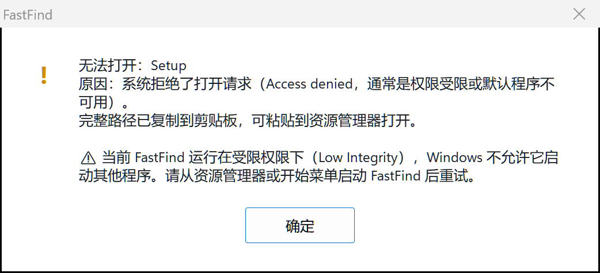

# FastFind 极速查找

Windows 本地文件查找器：单文件、免安装、零外部依赖。输入即搜，百万级文件索引在几十毫秒内出结果。

- 交付物：`FastFind.exe`（约 100 KB，x64，.NET Framework 4.8 系统自带运行时）
- 支持系统：Windows 10 1809+ / Windows 11（x64）
- 索引对象：本机 NTFS 固定磁盘（可在设置中勾选）
- 默认快捷键：`Ctrl+Alt+Space` 唤出 / 隐藏

## 界面预览

浅色主题：


深色主题：


打开失败时的提示（不会静默无反应）：\n\n\n\n设置窗口：


文件类型多选：


## 功能

- **极速索引**：多线程 `FindFirstFileExW`（`FindExInfoBasic` + `FIND_FIRST_EX_LARGE_FETCH`），本机 150 万条目冷扫描约 4–8 秒。
- **秒开**：索引以紧凑二进制缓存落盘，二次启动直接加载（约 30–300 ms），不必重新扫描。
- **即时搜索**：名称匹配 + 并行分片扫描，150 万条目常规查询 5–45 ms；输入防抖 60 ms，结果虚拟列表渲染。
- **完整查询语法**：多关键词 AND、通配符、正则、扩展名 / 大小 / 日期 / 路径过滤、排除项、文件类型过滤。
- **文件类型多选**：搜索框下方「类型」支持多选 文档 / 图片 / 视频 / 音频 / 压缩包 / 程序 / 代码 / 其他，多选为 OR 关系，勾选后立即生效。\n- **范围切换**：点击 C: / D: / E: 芯片可随时取消或恢复某个磁盘；全部取消时界面会提示，选择随设置持久化。
- **文件名高亮**：命中的关键词在结果中加粗着色。
- **虚拟结果表**：百万级结果只渲染可视行，滚动流畅；支持按列排序。
- **实用操作**：双击 / 回车打开、Ctrl+回车 打开所在文件夹、复制路径 / 文件名、查看属性、选择打开方式、删除到回收站（`SHFileOperation`，可撤销）。打开失败时会弹窗说明原因、自动在资源管理器中定位并复制路径，不会静默无反应。\n- **排序**：点击列头按名称 / 路径 / 大小 / 修改时间排序，再点切换升降序。
- **浅色 / 深色主题**：点击右上角图标或 `Ctrl+T` 实时切换，含深色标题栏与滚动条。
- **后台自动刷新**：文件变化后防抖重建索引（可在设置中关闭）。
- **便携**：配置与索引缓存在 exe 同目录 `data\`（不可写时回退 `%LOCALAPPDATA%\FastFind`），不写注册表。

## 快速开始

1. 双击 `FastFind.exe`。
2. 首次启动会自动索引勾选的磁盘，状态栏显示进度；索引过程中已可搜索已扫描部分。
3. 在搜索框输入关键词，结果即时出现。双击或回车打开，`Ctrl+回车` 打开所在文件夹。

首次索引完成后会在 `data\index\` 生成 `index-C.dat` 之类的缓存；之后启动秒开。

发布包有两个架构，按系统位数选择：

| 发布包 | 适用系统 |
| --- | --- |
| `FastFind-1.2.3-win64.zip` | 64 位 Windows 10 / 11（绝大多数人） |
| `FastFind-1.2.3-win32.zip` | 32 位 Windows（老机器 / 32 位系统） |

## 系统要求与低配建议

### 支持的系统

| 环境 | 状态 |
| --- | --- |
| Windows 10 1809+ / LTSC 2019 / Windows 11（x64） | ✅ 完整支持（PerMonitorV2 高 DPI、深色标题栏、UTF-8 代码页全部生效） |
| Windows 10 1703–1803 | ✅ 可用；深色标题栏在 1809 之前可能不生效，界面内容正常 |
| Windows 10 1507–1607 | ✅ 可用；DPI 走系统级缩放（跨屏拖动可能略糊） |
| Windows 8.1 / 7 | ⚠️ 未测试；manifest 声明 Win8+，主要 API 为 Vista/Win7 起可用，但不做承诺 |
| 32 位 Windows | ✅ 使用 `win32` 包（x86 构建） |
| Windows on ARM | ❌ 未支持（无 ARM64 构建） |

运行时依赖：**.NET Framework 4.x**（Windows 10/11 系统自带，无需安装）。不需要 .NET SDK、不需要管理员权限、不写注册表。

### 性能预期（按索引规模）

| 场景 | SSD / NVMe | 5400 转机械盘 |
| --- | --- | --- |
| 首次索引 30 万文件 | 1–2 s | 5–10 s |
| 首次索引 100 万文件 | 3–6 s | 20–50 s |
| 启动（读缓存） | 20–40 ms | 1.5–2.5 s |
| 搜索（100 万条目） | 30–60 ms | 60–150 ms |
| 常驻内存 50 万 / 150 万 / 300 万条目 | 约 60–70 / 170–215 / 350–420 MB | 同左（与磁盘无关） |

最低可用配置：双核 CPU、2 GB 内存、能装 .NET Framework 4.x 的系统；推荐 4 核 / 4 GB 以上。老机器上瓶颈几乎总是**首次索引的磁盘 IO**，不是 CPU 或界面。

### 老机器 / 低配建议

1. **关闭"文件变化后自动刷新索引"**：机械盘上后台重建会抢 IO；需要时手动按 `F5`。
2. **只用芯片打开需要的盘**：范围越小，索引越小、内存越省、搜索越快。
3. 把 FastFind 放在 **SSD 分区**（缓存读写都在 exe 旁 `data\`），首次索引完成后可整目录迁移。
4. 首次索引时**不要中途关窗口**：索引完成后才会写缓存，中途关闭下次要重扫。
5. 低分辨率屏幕可把「结果上限」调小（如 5000），滚动更顺；高 DPI 屏用默认缩放即可。
6. 32 位系统请用 `win32` 包；单个索引超过约 200 万条目时建议改用 64 位系统 + `win64` 包（32 位进程地址空间有限）。

## 查询语法

| 语法 | 说明 | 示例 |
| --- | --- | --- |
| `词1 词2` | 空格分隔，全部包含（AND） | `年度 报告` |
| `"短语"` | 精确短语（含空格） | `"Q3 review"` |
| `*` `?` | 通配符（`*` 任意串，`?` 单字符） | `2026*.pdf`、`IMG_????.jpg` |
| `/正则/` 或 `regex:` | 正则表达式（忽略大小写） | `/^IMG_\d{4}\.(jpe?g)$/` |
| `ext:` | 扩展名，逗号分隔取 OR | `ext:jpg,png` |
| `size:` | 大小过滤，支持 `>` `<` `>=` `<=` 与区间 | `size:>10mb`、`size:1mb..100mb` |
| `dm:` | 修改日期：`today` `yesterday` `thismonth`、`2026`、`2026-01`、`2026-01-01..2026-02-01` | `dm:today ext:log` |
| `dc:` / `date:` | 同 `dm:`（当前实现按修改时间） | `dm:2026-01..2026-02` |
| `path:` | 路径包含指定文本（匹配父目录链） | `path:项目 *.xlsx`、`path:"Program Files" ext:exe` |
| `-词` / `-ext:` | 排除匹配项 | `*.log -tmp`、`ext:psd -ext:tmp` |
| `type:file` / `type:dir` | 仅文件 / 仅文件夹 | `type:dir 项目` |

> 提示：默认只匹配文件名；`path:` 才会遍历父目录。正则 token 内的 `*` 按正则语义处理。

## 快捷键

| 快捷键 | 功能 |
| --- | --- |
| `Ctrl+Alt+Space` | 全局唤出 / 隐藏窗口 |
| `Ctrl+F` | 聚焦搜索框 |
| `Enter` | 打开选中项 |
| `Ctrl+Enter` | 打开所在文件夹 |
| `Ctrl+C` | 复制完整路径（多选换行） |
| `Ctrl+Shift+C` | 复制文件名 |
| `Alt+Enter` | 查看属性 |
| `Delete` | 删除到回收站 |
| `F5` | 重建索引 |
| `Ctrl+T` | 切换浅色 / 深色主题 |
| `Esc` | 清空搜索；再按隐藏窗口 |

## 设置

点击搜索框右侧齿轮图标：

- 勾选要索引的磁盘（默认所有本机 NTFS 固定盘，移动硬盘 / U 盘不默认加入）
- 文件变化后后台自动刷新
- 全局热键开关
- 深色主题
- 结果上限（1000–200000）
- 立即重建索引

## 性能实测（本机 Windows 11 / 16 线程 / NVMe）

| 项目 | 数据 |
| --- | --- |
| C: 扫描 81 万节点 | 1.7–4.1 s（约 20–47 万节点/秒） |
| 三盘合计 153 万节点 | 约 4–8 s，缓存 117 MB |
| 缓存保存 / 加载 | 27–38 ms / 21–31 ms |
| 查询 `setup` / `dll` / `*.log` | 31 / 40 / 33 ms |
| 查询 `ext:png` / `size:>10mb` / `dm:today` | 11 / 1 / 4 ms |
| `path:python`（1.5 万命中） | 48 ms |
| 常驻内存（153 万节点） | 约 170–215 MB 私有字节 |

## 构建

无需安装 .NET SDK，使用 Windows 自带的 .NET Framework 4 编译器：

```powershell
powershell -NoProfile -File .\build.ps1              # 64 位，产物 dist\FastFind.exe
powershell -NoProfile -File .\build.ps1 -Arch x86    # 32 位，产物 dist\x86\FastFind.exe
```

打包便携 zip：

```powershell
powershell -NoProfile -File .\package.ps1              # release\FastFind-1.2.3-win64.zip
powershell -NoProfile -File .\package.ps1 -Arch x86    # release\FastFind-1.2.3-win32.zip
```

产物（内嵌 PerMonitorV2 DPI manifest、图标、版本信息）：

- `dist\FastFind.exe`：PE32+（x64）
- `dist\x86\FastFind.exe`：PE32（x86，32 位）

x86 版本的引擎测试与 x64 完全一致：`.\build\x86\EngineTests.exe`（70 项断言）。32 位进程地址空间有限，单个索引建议控制在 200 万条目以内。

## 测试

```powershell
.\build\EngineTests.exe          # 70 项引擎断言
.\build\IndexBench.exe C:\ 8     # 扫描 / 缓存 / 查询基准
powershell -NoProfile -File .\acceptance.ps1   # 完整验收（20 项检查）
powershell -NoProfile -File .\tests\functional-test.ps1   # GUI 功能回归（14 项）
.\build\x86\EngineTests.exe      # 32 位引擎断言（可选）
```

最近一次验证结果：

| 套件 | 结果 | 覆盖 |
| --- | --- | --- |
| 引擎单元测试 | 70 passed / 0 failed | 扫描、缓存、路径、查询语法、类型分类、排序、范围掩码、取消 |
| 验收脚本 | PASS 20/20 | 构建、DPI manifest、首次索引、缓存、内存、单实例、退出保存、范围切换与持久化 |
| 功能测试 | PASS 14/14 | 8 类查询语法、自动刷新、Ctrl+C 复制路径、回收站删除、打开失败必有可见提示 |
| 自动刷新 | PASS | 新建文件后约 8–15 s 自动进入索引，无需手动刷新 |

## 代码结构

```
src/Core/Native.cs        Win32 互操作（FindFirstFileEx、卷信息、总线类型、文件属性）
src/Core/IndexModel.cs    卷索引：SoA 数组 + char 名池，路径按需重建
src/Core/Scanner.cs       多线程目录扫描器（工作队列 + 批量合并）
src/Core/CacheStore.cs    二进制缓存读写（原子替换、分块 IO）
src/Core/Query.cs         查询语法解析器
src/Core/SearchEngine.cs  并行名称/路径匹配与相关性排序
src/Core/IndexManager.cs  索引生命周期、缓存加载、FileSystemWatcher 刷新
src/Core/Settings.cs      便携配置与磁盘检测
src/UI/                   WinForms 界面（自绘头部、虚拟列表、主题、设置）
tests/EngineTests.cs      引擎单元测试
tools/                    开发期基准与辅助工具（不随包分发）
```

## 双击打不开怎么办

1. 状态栏若提示「受限权限运行」，说明当前副本是从智能体面板/浏览器等受限环境启动的：关掉它，改用资源管理器或开始菜单启动 `FastFind.exe`。
2. 弹窗提示「默认程序不可用 / Access denied」：右键结果 →「选择打开方式…」，或在系统「设置 → 应用 → 默认应用」中修复该扩展名的关联。
3. 弹窗提示「文件已不存在」：按 `F5` 重建索引后再试。


## 已知限制

- 索引使用普通用户权限的目录枚举；无管理员时不使用 USN/MFT 快速路径（需要管理员权限，后续可作为可选加速）。
- 跳过符号链接 / junction，避免目录环。
- 只默认索引本机 NTFS 固定盘；网络盘、移动盘可通过设置手动添加（需自行承担扫描耗时）。
- 运行期刷新采用「防抖 + 按卷重建」，文件剧变时会有一次数秒的重建；对实时性要求极高的场景可关闭自动刷新并手动 `F5`。
- 若 FastFind 以受限令牌（Low Integrity，例如从智能体面板或浏览器里启动）运行，Windows 会拒绝它启动其他程序。程序会自动检测并在状态栏与失败弹窗中提示「请从资源管理器或开始菜单启动 FastFind」。
- 系统默认程序损坏或未关联（例如部分 AppX 应用容器缺失）时，会显示具体原因，可用右键「选择打开方式…」或「设置 → 应用 → 默认应用」修复。
- 「打开所在文件夹」使用 `SHOpenFolderAndSelectItems`（不启动 `explorer.exe`），受限环境下不会再多弹一个 explorer 崩溃框。
- 缓存以卷序列号校验；换盘或格式化后会自动失效重建。


